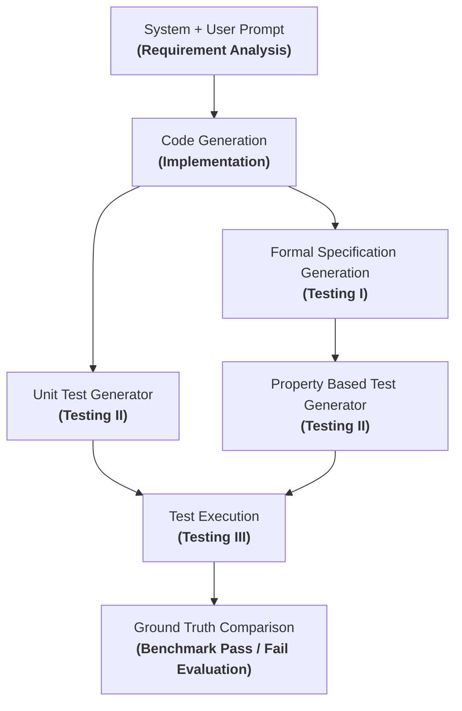

# FaultDetection_using_AgenticAI: Extended AgentCoder 2.0

> Fault Detection and Code Generation using Agentic AI with Formal Specifications & Property-Based Testing (20-Credit Course Project).

This project contains both the baseline vanilla AgentCoder (`Vanilla_Method/`) and the **Extended AgentCoder 2.0** framework integrating a formal-specification stage and a property-based testing branch across benchmarks: **MBPP**, **DS-1000**, **API-Bank**, and **BigCodeBench**.

## Architecture



### Stage Summary

- **Requirement Analysis**: Transforms task description into concise, implementation-independent constraints.
- **Code Generation (Implementation)**: Produces the Python candidate implementation.
- **Unit Test Generator (Testing II)**: Generates independent example-based unit tests from requirements and signature.
- **Formal Specification Generation (Testing I)**: Produces structured formal contracts (Preconditions, Postconditions, Invariants).
- **Property-Based Test Generator (Testing II)**: Produces Hypothesis property-based tests from the formal specification.
- **Test Execution (Testing III)**: Executes the implementation against both test branches.
- **Ground Truth Comparison**: Evaluates the candidate against reference benchmark test suite in isolated subprocess.


## Relationship to AgentCoder

This repository keeps the original multi-agent shape of AgentCoder:
- programmer agent
- test generation
- execution
- refinement loop

What changes in the extended mode is the test source:
- baseline mode keeps a classic AgentCoder-style code → tests → execute → refine loop (also found in `Vanilla_Method/`)
- extended mode inserts formal specification generation before both test branches

## LLM-Formal-Spec integration

The formal-spec stage is implemented in `formal_spec/pipeline.py` and `formal_spec/adapter.py`.

The adapted pipeline uses the same three conceptual stages as the source repository:
1. annotation
2. lifting
3. translation

The adapter consumes the task text and emits a structured specification object containing fields such as:
- operationId
- operationName
- actionable_sentences
- lifted_nl
- LABEL
- Precondition
- Function
- Postcondition

Validation is schema-based and retry-aware:
- JSON parsing is enforced
- required fields are checked
- invalid outputs trigger repair attempts up to the configured retry limit

## Benchmark Handling

- **MBPP**: Handled via `dataset/mbpp_loader.py` and `evaluation/evaluator.py`.
- **DS-1000**: Handled via `dataset/ds1000_loader.py` and `evaluation/ds1000_evaluator.py`.
- **API-Bank**: Multi-turn dialogue evaluation via `dataset/api_bank_loader.py` and `evaluation/api_bank_evaluator.py`.
- **BigCodeBench**: Handled via `dataset/bigcodebench_loader.py` and `evaluation/bigcodebench_evaluator.py`.

Generation inputs contain only task metadata, description, and signature. Benchmark reference tests never enter the generation prompts and are kept strictly for final evaluation.

### Running Benchmarks

#### Run a single task
```bash
python main.py --dataset mbpp --task-id 42 --mode extended
```

#### Run a subset
```bash
python main.py --dataset mbpp --split test --limit 10 --mode extended
```

#### Run the baseline
```bash
python main.py --dataset mbpp --split test --limit 10 --mode baseline
```

#### Head-to-Head Comparison Table
```bash
python generate_benchmark_table.py
```

## Repository Structure

```
├── Vanilla_Method/          # Aaditya Gole's vanilla AgentCoder baseline
├── agents/                  # Multi-agent system (Programmer, Unit Test, Property Test, etc.)
│   ├── common.py
│   ├── programmer_agent.py
│   ├── property_test_agent.py
│   ├── requirement_analyzer.py
│   ├── test_executor.py
│   └── unit_test_agent.py
├── dataset/                 # Dataset loaders (MBPP, DS-1000, API-Bank, BigCodeBench)
├── evaluation/              # Benchmark evaluators
├── formal_spec/             # Formal specification generation and verification
├── llm/                     # LLM gateway client (Kilo, OpenAI compatible)
├── prompts/                 # Prompt templates
├── tests/                   # Core unit and integration test suite
├── utils/                   # Artifact management and logging
├── config.py                # Configuration and environment management
├── generate_benchmark_table.py
├── main.py                  # CLI entrypoint
├── requirements.txt
├── .env.example
└── .gitignore
```

## Notes

- The repository is configured for real LLM-backed runs through Kilo or another OpenAI-compatible provider.
- MBPP generation path does not consume reference solutions or benchmark tests.
- The formal-spec stage is adapted from the existing LLM-sts-pipeline structure.
