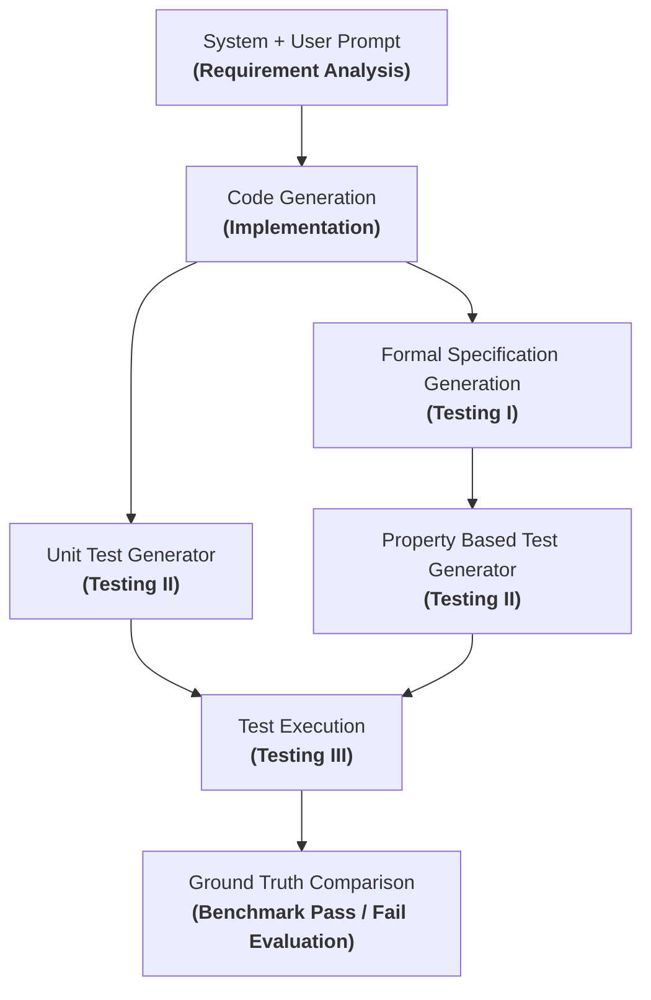

# Extended AgentCoder: Formal Specifications & Property-Based Testing

This project extends the original AgentCoder framework by integrating a formal-specification stage and a property-based testing branch across three benchmarks: **MBPP**, **DS-1000**, and **API-Bank**.

## Architecture



### Stage Summary

- **Requirement Analysis**: Transforms task description into concise, implementation-independent constraints.
- **Code Generation (Implementation)**: Produces the Python candidate implementation.
- **Unit Test Generator (Testing II)**: Generates independent example-based unit tests from requirements and signature.
- **Formal Specification Generation (Testing I)**: Produces structured formal contracts (Preconditions, Postconditions, Invariants).
- **Property-Based Test Generator (Testing II)**: Produces Hypothesis property-based tests from the formal specification.
- **Test Execution (Testing III)**: Executes the implementation against both test branches.
- **Ground Truth Comparison**: Evaluates the candidate against reference benchmark test suite in isolated subprocess.


## Relationship to AgentCoder

This repository keeps the original multi-agent shape of AgentCoder:
- programmer agent
- test generation
- execution
- refinement loop

What changes in the extended mode is the test source:
- baseline mode keeps a classic AgentCoder-style code → tests → execute → refine loop
- extended mode inserts formal specification generation before both test branches

## LLM-Formal-Spec integration

The formal-spec stage is implemented in `formal_spec/pipeline.py` and `formal_spec/adapter.py`.

The adapted pipeline uses the same three conceptual stages as the source repository:
1. annotation
2. lifting
3. translation

The adapter consumes the MBPP task text and emits a structured specification object containing fields such as:
- operationId
- operationName
- actionable_sentences
- lifted_nl
- LABEL
- Precondition
- Function
- Postcondition

Validation is schema-based and retry-aware:
- JSON parsing is enforced
- required fields are checked
- invalid outputs trigger repair attempts up to the configured retry limit

## MBPP dataset handling

MBPP problems are loaded through `dataset/mbpp_loader.py`.

Generation input contains only:
- task_id
- text
- entry_point

Reference data such as the canonical solution and benchmark tests are kept in the evaluation view only.

Evaluation runs after generation and may use the benchmark reference tests available in the dataset record. These tests never enter the generation prompts in the default flow.

### Run a single task

```bash
python main.py --dataset mbpp --task-id 42 --mode extended
```

### Run a small subset

```bash
python main.py --dataset mbpp --split test --limit 10 --mode extended
```

### Run the baseline

```bash
python main.py --dataset mbpp --split test --limit 10 --mode baseline
```

## Kilo configuration

Kilo is used as an OpenAI-compatible provider.

Example environment configuration:

```bash
LLM_PROVIDER=kilo
MODEL_PROVIDER=kilo
KILO_BASE_URL=https://api.kilo.ai/api/gateway
KILO_API_KEY=<your-key>
KILO_MODEL=<model>
```

Optional stage-specific overrides:

```bash
CODE_GENERATION_MODEL=
FORMAL_SPEC_MODEL=
UNIT_TEST_MODEL=
PROPERTY_TEST_MODEL=
```

## Installation

```bash
python -m venv .venv
source .venv/bin/activate
pip install -r requirements.txt
```

## Running the system

### Extended mode

```bash
python main.py --dataset mbpp --split test --limit 10 --mode extended
```

### Baseline mode

```bash
python main.py --dataset mbpp --split test --limit 10 --mode baseline
```

### Single task

```bash
python main.py --dataset mbpp --task-id 42 --mode extended
```

## Configuration

Important environment variables:

| Variable | Purpose |
| --- | --- |
| `LLM_PROVIDER` / `MODEL_PROVIDER` | Selects the backend provider |
| `KILO_BASE_URL` | OpenAI-compatible gateway URL |
| `KILO_API_KEY` | Kilo API key |
| `KILO_MODEL` | Default Kilo model |
| `CODE_GENERATION_MODEL` | Optional code model override |
| `FORMAL_SPEC_MODEL` | Optional formal-spec model override |
| `UNIT_TEST_MODEL` | Optional unit-test model override |
| `PROPERTY_TEST_MODEL` | Optional property-test model override |
| `MAX_ITERATIONS` | Maximum refinement iterations |
| `TEST_TIMEOUT_SECONDS` | Subprocess timeout for test execution |
| `OUTPUT_DIR` | Root folder for run artifacts |
| `DATASET_LOCAL_PATH` | Optional local MBPP JSON file |

## Output and artifacts

Generated artifacts are stored under `runs/mbpp/<task_id>/`.

Typical layout:

```text
runs/
  mbpp/
    <task_id>/
      problem.json
      iteration_0/
        generated_code.py
        requirement_analysis.json
        formal_specification/
          formal_spec.json
          formal_spec_artifacts.json
        unit_tests/
          unit_tests.py
          unit_tests_meta.json
        property_tests/
          property_tests.py
          property_tests_meta.json
        execution_results.json
        feedback.json
      final/
        solution.py
        evaluation_results.json
```

## Experimental modes

### Baseline

Uses the original AgentCoder-style loop:
- code generation
- unit tests
- execution
- feedback

### Extended

Adds:
- formal specification generation
- unit tests derived from the specification
- property-based tests derived from the specification

Both modes are kept so the benchmark can compare the effect of the formal-spec and property-test additions.

## Evaluation

The runner reports:
- initial generated-code results
- unit-test results
- property-test results
- final generated-code results
- MBPP evaluation results
- number of refinement iterations

Reference solution and reference tests are not provided to the generation agents in the default flow.

## Project structure

```text
.
├── main.py
├── config.py
├── requirements.txt
├── .env.example
├── .gitignore
├── README.md
├── agents/
│   ├── common.py
│   ├── programmer_agent.py
│   ├── property_test_agent.py
│   ├── requirement_analyzer.py
│   ├── test_executor.py
│   └── unit_test_agent.py
├── dataset/
│   └── mbpp_loader.py
├── evaluation/
│   └── evaluator.py
├── formal_spec/
│   ├── adapter.py
│   └── pipeline.py
├── llm/
│   └── client.py
├── prompts/
│   ├── formal_spec_annotation.txt
│   ├── formal_spec_lift.txt
│   ├── formal_spec_translate.txt
│   ├── programmer_prompt.txt
│   ├── property_test_prompt.txt
│   ├── requirement_analysis.txt
│   └── unit_test_prompt.txt
├── tests/
│   └── test_core.py
└── runs/
```

## Notes

- The repository is configured for real LLM-backed runs through Kilo or another OpenAI-compatible provider.
- The MBPP generation path does not consume the reference solution or benchmark tests.
- The formal-spec stage is adapted from the existing LLM-sts-pipeline structure rather than replaced by a new generic spec system.
